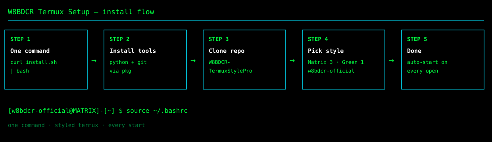
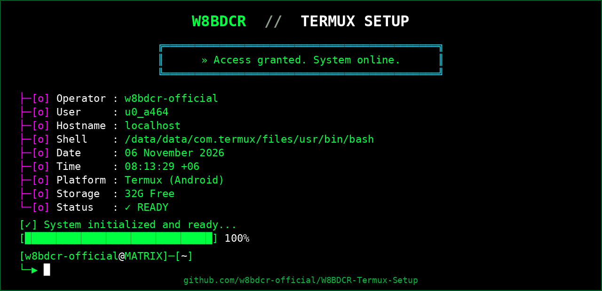

# ⚡ 1) Install & run

### 📱 Termux (Android) Quick Install:

```
curl -fsSL https://raw.githubusercontent.com/w8bdcr-official/W8BDCR-Termux-Setup/main/install.sh | bash
```

> 💡 Tip: To re-apply the look anytime, just re-run the installer — it is safe to run again and re-applies the same style.

### ▶️ Then just run it:

```
source ~/.bashrc
```

> The banner appears on every Termux start automatically. Or close and reopen Termux — no command needed.



# 🚀 W8BDCR Termux Setup — Styled Termux in One Command



[](LICENSE)
[](https://termux.dev)
[](install.sh)

**One command. Styled Termux. Every time you open it.**

W8BDCR Termux Setup installs [W8BDCR-TermuxStylePro](https://github.com/w8bdcr-official/W8BDCR-TermuxStylePro) and applies the W8BDCR look — Matrix style, green color, `w8bdcr-official` name — with zero prompts. Set up a phone once, and the next phone is one command and done. No asking anyone for help.

# 💥 The Promise

- **One command** — nothing to choose, nothing to type, nothing to remember
- **Zero prompts** — style, name and color are pre-filled with the W8BDCR defaults
- **Every start** — the banner and the `[w8bdcr-official@MATRIX]` prompt load on every Termux open
- **Safe to re-run** — run it again anytime, it just re-applies the same look

# 🤔 Why this?

Setting up a styled Termux by hand means five commands plus three prompts — style, name, color — and one wrong filename stops the whole thing (the tool's own README prints the wrong filename). This project packs all of it into a single command with the right answers already filled in, so the next setup takes seconds and needs nobody's help.

# ⚡ Quick Start

# ══ STEP 1 · Install ══
# › One command in Termux — downloads and runs the W8BDCR installer.
# › It installs Python and git, clones TermuxStylePro, and applies the look.
# › Already styled? Re-run this once — it re-applies the same look in place.

```
curl -fsSL https://raw.githubusercontent.com/w8bdcr-official/W8BDCR-Termux-Setup/main/install.sh | bash
```

# ══ STEP 2 · See it now ══
# › Run this once, right after the install finishes.
# › It loads the banner into the current session — no restart needed.

```
source ~/.bashrc
```

# ══ STEP 3 · Just use it ══
# › Close and reopen Termux — the banner is there on every start.
# › Your prompt reads [w8bdcr-official@MATRIX].
# › Want a different style later? See Customize below.

# 🔧 Manual setup — full commands, step by step

If the one command above gives you trouble, run these one by one — same result, nothing hidden. Type each line, press Enter, wait for it to finish, then the next.

**1. Install Python and git:**

```
pkg update -y && pkg install -y python git
```

**2. Download the styler:**

```
git clone https://github.com/w8bdcr-official/W8BDCR-TermuxStylePro
```

**3. Go inside it:**

```
cd W8BDCR-TermuxStylePro
```

**4. Run it and answer the three questions:**

```
python W8TermuxStylePro.py
```

- Style → type `3` (Matrix) and press Enter
- Name → type `w8bdcr-official` and press Enter
- Color → type `1` (Green) and press Enter

> ⚠️ The file is `W8TermuxStylePro.py` — not `W8BDCR-TermuxStylePro.py`. The wrong name gives "No such file".

**5. See it now:**

```
source ~/.bashrc
```

# 🎬 In Action

What you see after the install:

```
┌─────────────────────────────────────────────┐
│  SYSTEM INFO                                │
│  Operator: w8bdcr-official                  │
│  Status: ✓ READY                            │
│  » Access granted. System online.           │
└─────────────────────────────────────────────┘

[w8bdcr-official@MATRIX]─[~]
```

Verified on a real phone — Termux on Android, 2026-11-06: the SYSTEM INFO box and the `[w8bdcr-official@MATRIX]` prompt appear exactly like this. The installer itself was also tested end-to-end before release (welcome script + launcher + `~/.bashrc` auto-start all verified).

# ✨ Features

- **One command, zero prompts** — Matrix (3), Green (1), `w8bdcr-official`, all pre-filled
- **No dependencies to install by hand** — the installer brings Python and git on Termux
- **Auto-startup** — the welcome script is added to `~/.bashrc`, so it loads on every start
- **100 styles available** — Matrix is the default; any other style is one variable away
- **Works on Termux and Linux** — on Linux it checks for `python3` and `git` instead of using `pkg`

# ⚙️ How it works

1. Installs Python and git (Termux: `pkg install python git`)
2. Clones [W8BDCR-TermuxStylePro](https://github.com/w8bdcr-official/W8BDCR-TermuxStylePro) — skipped if already present
3. Runs the styler non-interactively with style `3`, name `w8bdcr-official`, color `1`
4. The styler writes the welcome script and adds it to `~/.bashrc`

# 🎨 Customize

Set the variables before running the installer to change the look:

```bash
W8_STYLE=71 W8_NAME=myname W8_COLOR=4 bash install.sh
```

| Variable | Default | Meaning |
|----------|---------|---------|
| `W8_STYLE` | `3` | Style number (3 = Matrix, 71 = Kali Linux, 15 = Mr Robot, 13 = Cyberpunk) |
| `W8_NAME` | `w8bdcr-official` | Name/handle shown in the banner and prompt |
| `W8_COLOR` | `1` | Color number (1 = Green, 2 = Red, 3 = Blue, 4 = Cyan) |

To pick by hand instead, run the styler directly:

```bash
cd ~/W8BDCR-TermuxStylePro
python W8TermuxStylePro.py
```

# 🗑️ Uninstall

Run the styler and choose **101 (Remove)**:

```bash
cd ~/W8BDCR-TermuxStylePro
python W8TermuxStylePro.py
```

Then remove the folders:

```bash
rm -rf ~/W8BDCR-TermuxStylePro ~/W8BDCR-Termux-Setup
```

# 📧 Community & Help

- ⭐ Star this repo if it helps you
- 💬 Telegram: [@W8BDCR](https://t.me/W8BDCR)

# 📄 License

MIT — see [LICENSE](LICENSE). Copyright (c) 2026 W8BDCR.
